# Connected operating workflows

Edition 1.0 · Proposed guarded workflows. Open [WORKFLOW-MAPS.html](WORKFLOW-MAPS.html) for rendered diagrams. Each map is one relationship/decision sequence; sources below remain editable Mermaid definitions. Data/payment/provider actions also follow specs 63–76. Diagrams do not replace detailed rule and permission contracts.

## Team invitation and access

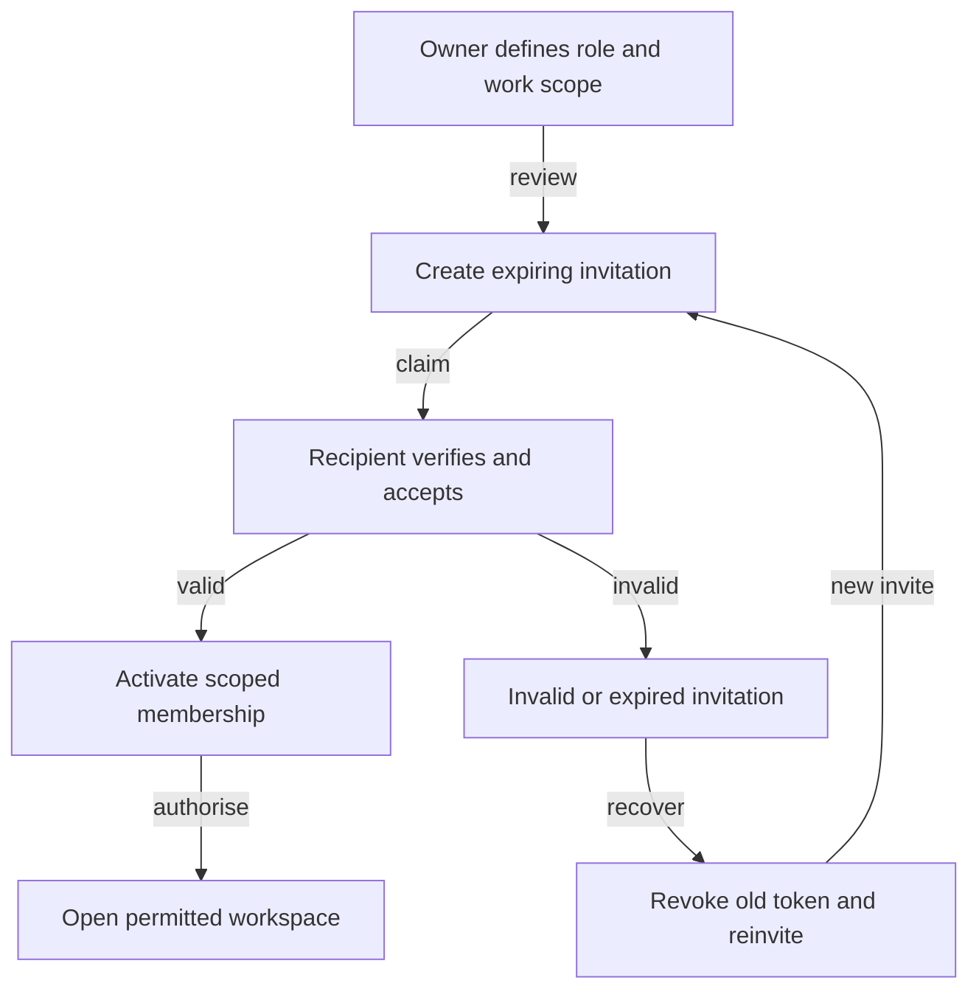

## Professional profile publication

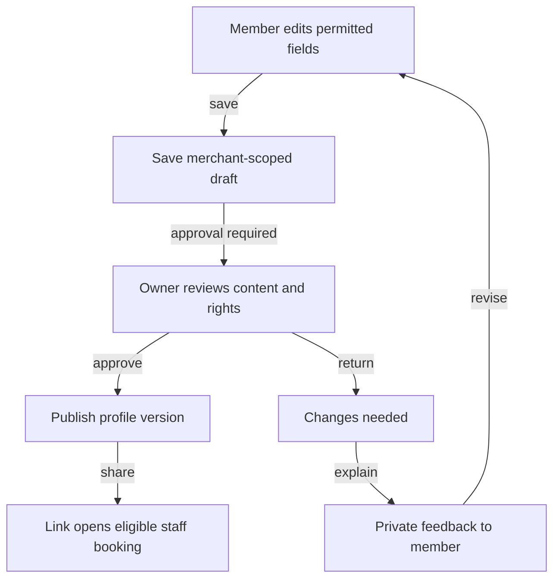

## Booking and payment commitment

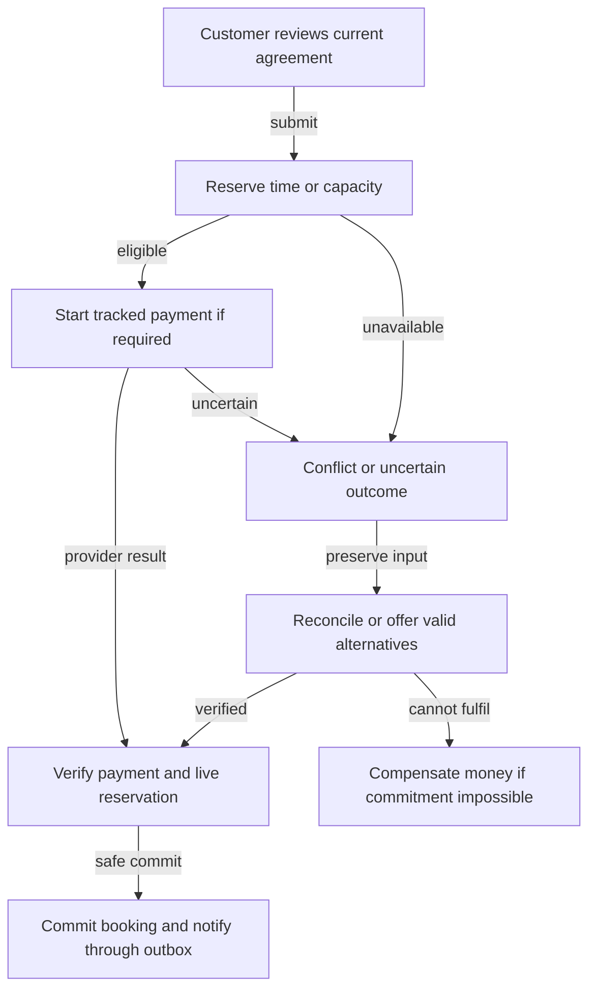

## Safe rescheduling

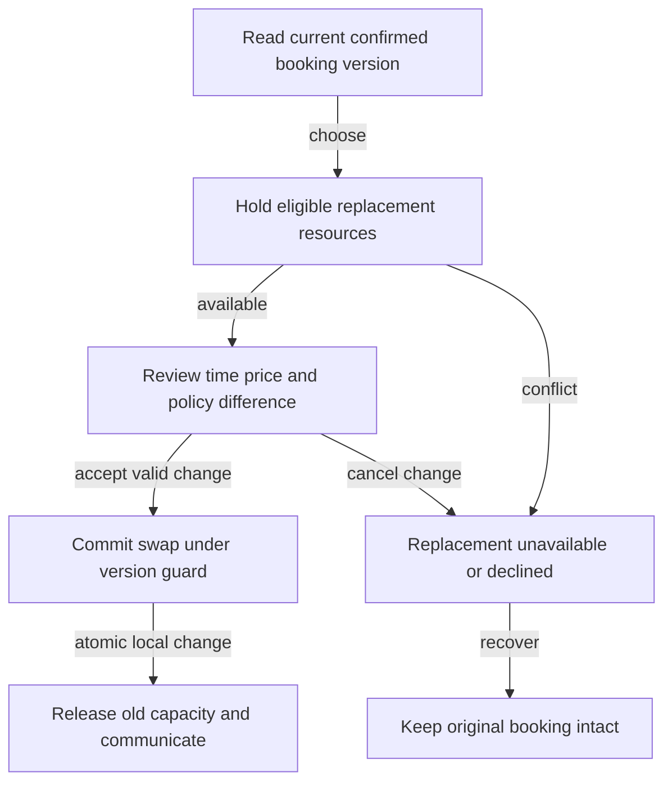

## Cancellation and refund

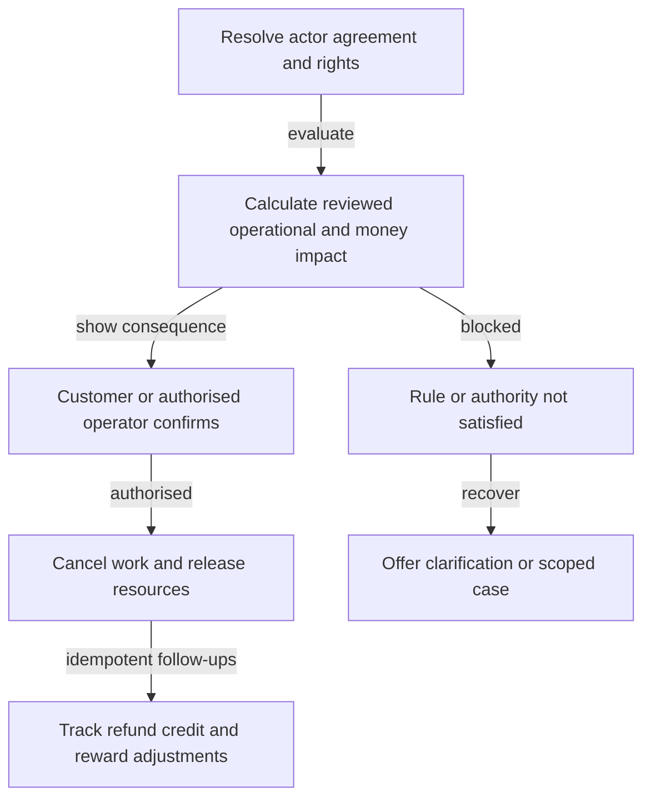

## Waitlist offer and expiry

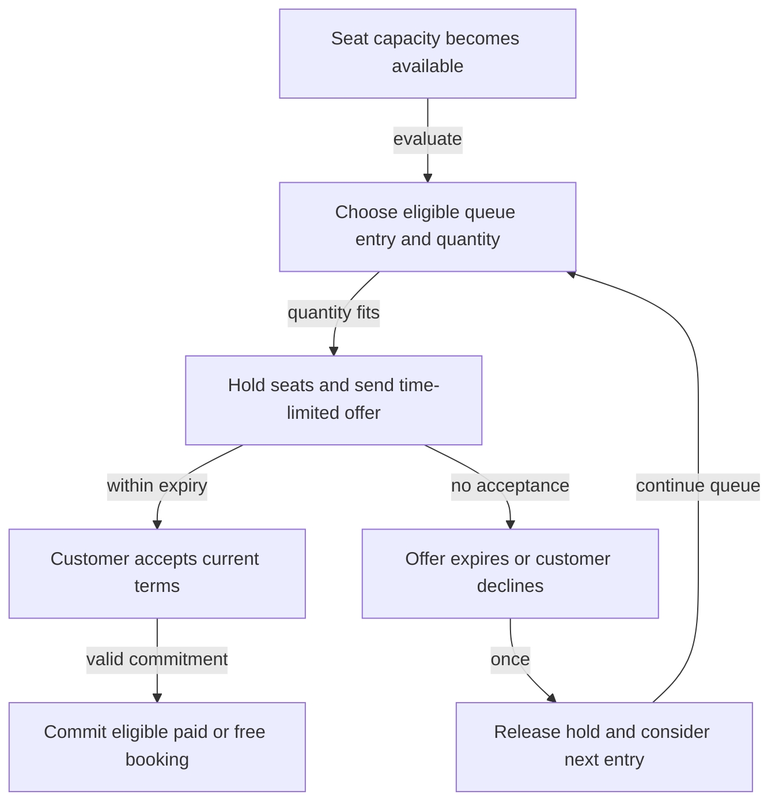

## Return disposition and money

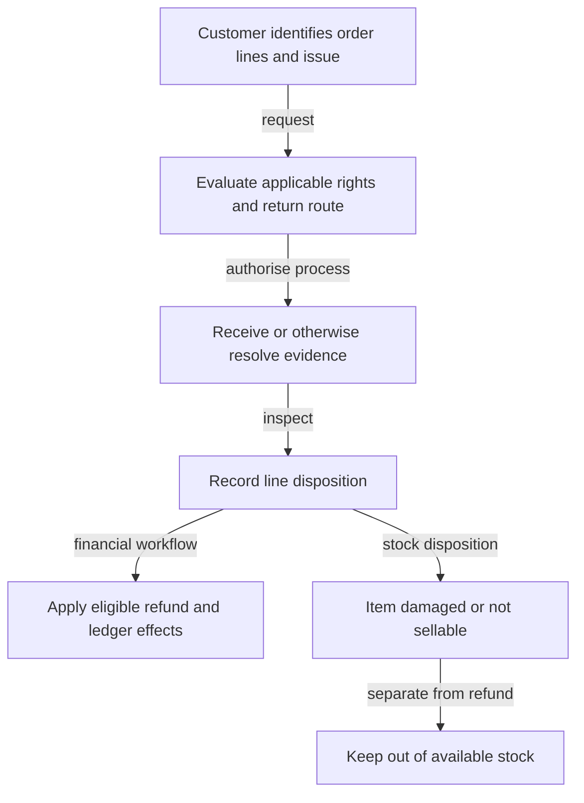

## Team departure

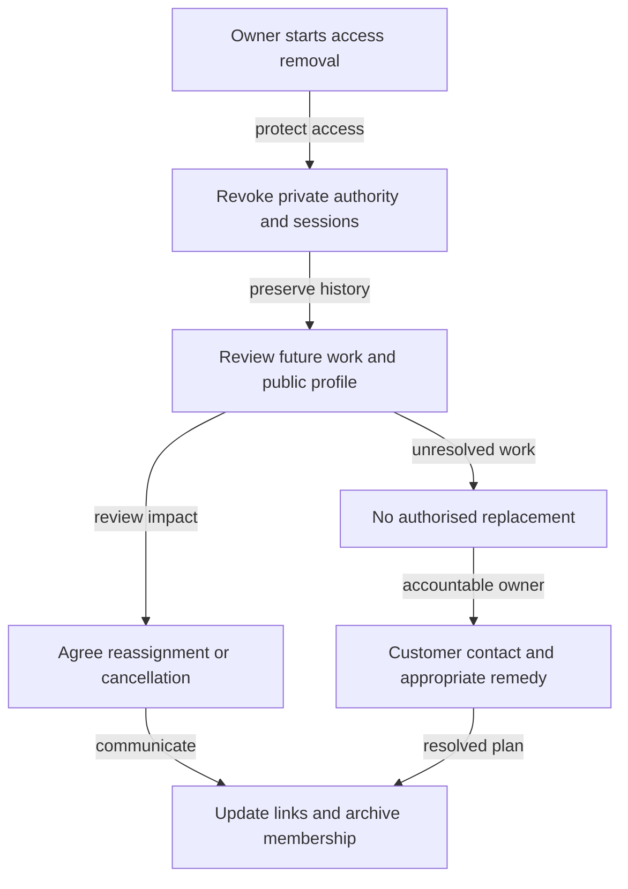

## Private data request

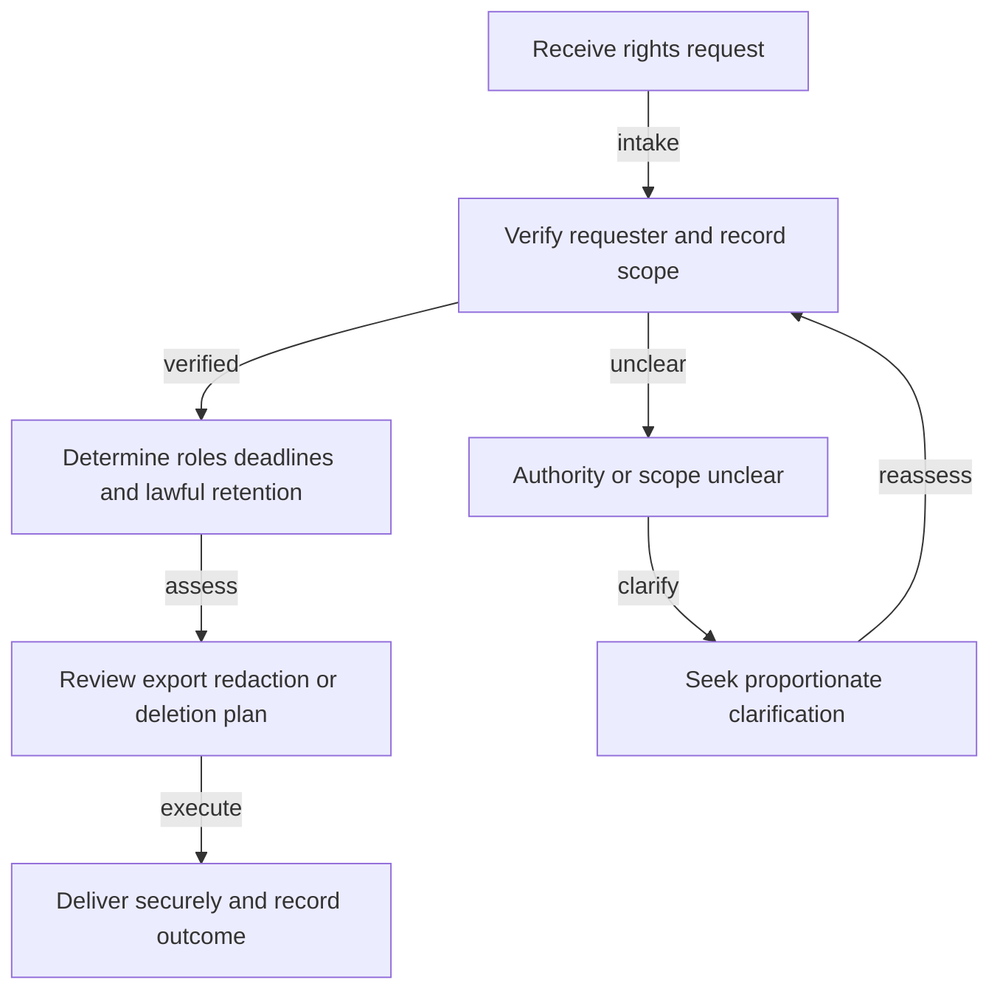

## Merchant closure

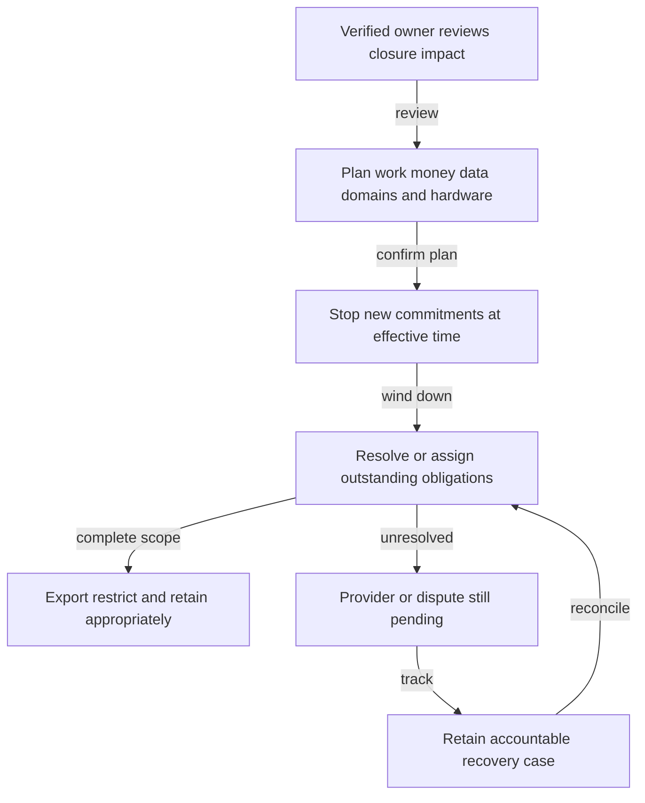

## Policy change to enforced behaviour

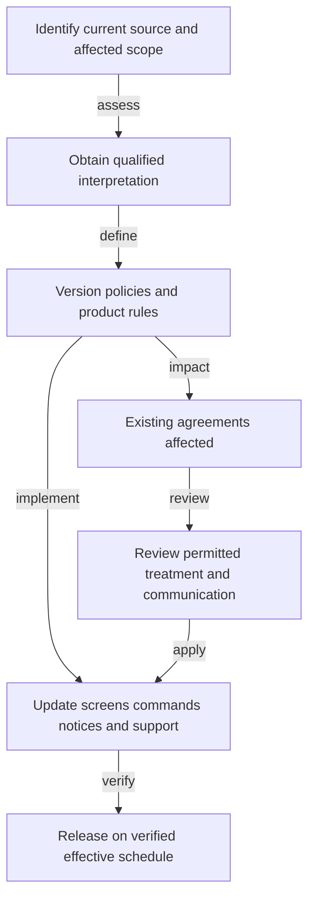

