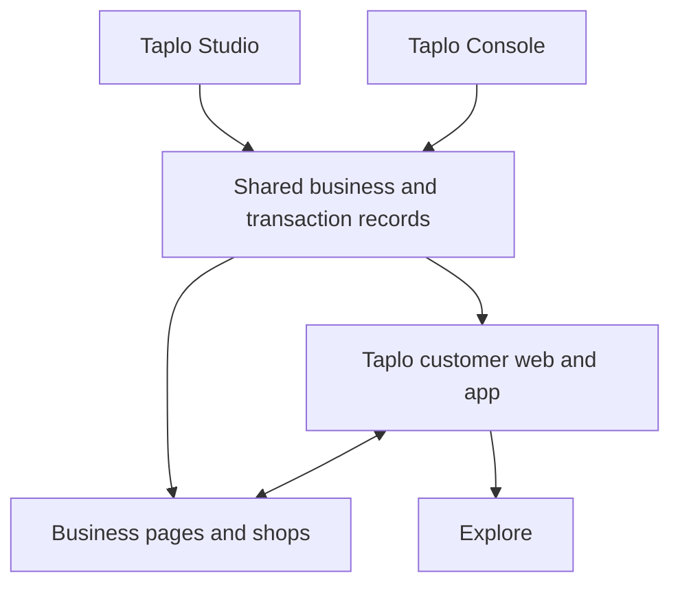

> Historical research edition 0.2, preserved for evidence and context. The current START-HERE and decision register supersede any implication that earlier design/data choices are locked. Recommendations remain revisable.

# Taplo — native commerce, Studio and the customer ecosystem

Product identity, current-platform research and feature blueprint · 31 October 2026 · Version 0.2

## The short pitch

**Your business, all together.**

Taplo gives an independent business a branded home, a native shop, booking and enquiry tools, and one workspace for managing the customer activity they generate. Studio adapts to what the business does. Customers can discover a business, buy, book, ask a question and return to their activity through Taplo on the web or in its customer app.

Picture a mechanic offering a battery with fitting, a barber selling appointments and styling products, a maker shipping products and running workshops, or a tutor offering sessions and revision resources. Each gets a different working setup, built on shared business, customer, commerce and scheduling foundations.

The proposition to develop is the coherence and ease of that experience: an owner can offer several kinds of value without assembling and maintaining separate business systems. Customers can act on an offer without repeating their requirements across disconnected steps.

The strongest opportunity to test is among independent owners and small teams with a mixture of products, services and customer relationships. This is a product recommendation, not a claim that the combination is unique or that its ease advantage has already been measured.

## 1. Direction established by the founder

- **Native commerce belongs inside Taplo.** The commerce proposition includes Taplo product management, checkout, orders and customer journeys. Connecting an existing shop is not the proposed commerce offering.
- Setup and ongoing Studio use must be simple, guided and convenient. Necessary merchant information, policies and transaction controls remain part of the journey.
- Studio adapts to business category and operating needs. Several capabilities are already part of the foundation; this work should extend them coherently.
- Support businesses selling services, products, time, expertise and combinations of these. Categories recommend; they do not lock owners out of useful capabilities.
- Discovery is optional. Direct links, social audiences, existing customers, recommendations and QR/NFC sharing also lead to the business.
- Preserve the mobile-first design ambition, shared renderer, editable appearance and separation of real content from design. Changing a look preserves content.
- Commercial plan names, prices, allowances and commission policies remain open.
- Product-facing wording describes the finished experience directly. Implementation tracking belongs in internal development material. This document describes the offering and identifies source foundations; it is not a launch-readiness audit.

## 2. The ecosystem: two customer-facing products, connected public surfaces

Recommend two primary product identities: **Taplo** for customers and **Taplo Studio** for businesses. Business pages and Explorer belong within that ecosystem. An internal console supports operations.

| Surface | Audience and responsibility | Recommended identity and access |
| --- | --- | --- |
| Marketing website | Explains Taplo, shows examples, demonstrates workflows and invites businesses to start | Taplo at `mytaplo.com`; Create your business leads into setup/Studio |
| Public business pages and shops | A business's branded destination, with offers, native buying/booking/enquiries and useful business information | `mytaplo.com/<handle>` and supported custom domains; full mobile-browser experience |
| Customer web/app experience | Saved businesses, orders, bookings, quotes, conversations and personal preferences | **Taplo**; the same customer account across web and app |
| Discovery | Searches, categories, relevant offers and optional local discovery | **Explore**, a section of Taplo, also available publicly on the web |
| Owner workspace | Page editing, shop, services, customer activity, fulfilment, scheduling, team and business settings | **Taplo Studio**, using the existing planned `app.mytaplo.com` destination |
| Internal operations | Support, merchant assistance, disputes, refunds oversight, moderation, messaging operations and service health | **Taplo Console**, restricted to authorised internal roles |

The exact paths are proposed information architecture, not deployed routing changes. Reserve system routes such as Explore, account and support so they cannot conflict with business handles.

### How the parts fit

The records layer includes identity, catalogue, availability, customer relationships, orders, bookings, payments and communication events. The arrows describe shared responsibilities, not a required microservice architecture.

An owner changes an offer in Studio. The business page and eligible discovery surfaces use that current offer. A customer places an order or booking. Studio receives the corresponding work; the customer sees the corresponding activity. Existing transactions retain their agreed prices, terms and scope when the catalogue changes.

### One person, distinct roles

A person may buy from several businesses and also own or work in one. Use one account identity with explicit business memberships and roles, rather than forcing separate personal and business accounts.

Personal activity and merchant records have different access boundaries. Each business sees its own customer relationship and authorised information. A shared customer account does not grant merchants access to the person's relationships with other businesses.

A browser visitor can browse and use suitable guest flows. Private records require secure access. A later account claim must verify ownership before attaching historic guest activity. Installing the customer app should improve convenience rather than gate basic shopping or booking.

## 3. What the current 2026 landscape establishes

Research uses current first-party product documentation and release material, checked 31 October 2026. These sources establish advertised capabilities and documented workflows. They are not an independent comparative usability study.

| Current platform | Relevant evidence | Implication for Taplo |
| --- | --- | --- |
| **Shopify and Shop** | Fall 2026 includes expanded AI-assisted administration and a connected customer shopping experience. Shop combines discovery, saved preferences, checkout and order activity. Shopify documents an appointment-app ecosystem. [R1–R3] | Compare against modern setup assistance and the customer ecosystem, not a historical store builder. A native service-and-product operating experience is a concrete dimension to investigate |
| **Wix and Spaces** | Wix supports products and booking services in one online cart. Spaces supports buying, booking, messaging and member activity. Wix also has AI-assisted site creation and owner mobile management. [R4–R7] | This is a direct ecosystem comparison. Mixed buying and booking or a customer app alone cannot be presented as Taplo's unique invention |
| **Square** | Current UK offering spans appointments, classes, payments, stock, fulfilment and customer management. Scheduling documentation includes resources and processing time. [R8–R9] | Compare complete daily operations. A coherent shop plus calendar is an established expectation |
| **Beacons** | Recent 2026 updates include AI-led store administration, appointment schedules, shared editing patterns and connected tools. [R10] | Adding an AI assistant or combining creator tools is not sufficient differentiation. Study which real tasks become simpler |
| **Linktree** | Current offering includes bookings, digital products, courses, audience management, social planning and automated DMs. [R11] | The baseline for a lightweight business destination already includes selling and audience tools |
| **Fresha and Booksy** | Both combine customer acquisition with business operations. Fresha documents retail, group appointments, resources, processing time and custom websites. [R12–R14] | Avoid reducing these to discovery directories. Learn from their full appointment lifecycle while designing for broader operating models |
| **SumUp and Big Cartel** | SumUp documents guided store setup, stock, fulfilment, notifications and returns. Big Cartel supports variants, inventory and selling tools for smaller sellers. [R15–R17] | Simple native commerce already has credible alternatives. Taplo must demonstrate actual effort reduction and useful connections to services |
| **Ecwid** | Supports native selling and service products. Its documented embedded-calendar booking route requires the merchant to create calendar events manually after an order. [R18] | This specific workflow illustrates a handover that a coordinated native booking-and-order model can avoid. Other Ecwid apps and methods may work differently |
| **Jobber, HoneyBook and Dubsado** | Customer hubs, quotes, invoices, project communication and connected client journeys are established features. [R19–R21] | A private customer page or quote approval is a useful capability, not a standalone novelty claim |
| **TutorBird and Bookwhen** | Specialist tools cover family/student relationships, recurring education administration, group capacity, passes and memberships. [R22–R23] | Real category adaptation must include operating rules and records, not just labels and illustrations |

### The opportunity worth pursuing

Build a guided, category-aware operating experience around businesses whose work spans more than one transaction type. The potential advantage is the amount of work an owner and customer avoid across setup, purchase, fulfilment and repeat use.

Do not claim every existing platform is complicated. The founder's concern about setup effort is a hypothesis for a target segment. Compare the same real tasks against current products, including their AI assistance, presets and mobile workflows.

## 4. The common product foundation

| Shared foundation | Required behaviour |
| --- | --- |
| Business identity | Brand, handle, legal seller identity where relevant, contacts, locations, service areas, time zone and publication settings |
| Offers | Products, services, packages and item-specific enquiries with appropriate media, price, delivery method and availability |
| Customer relationships | Contact information, transaction history, consent, relevant participants and item/service context |
| Commerce | Cart, checkout, orders, payments, fulfilment, refunds, customer notifications and receipts |
| Scheduling | Staff availability, appointments, requests, capacity, time rules, resource requirements and changes |
| Communication | Messages and transactional updates attached to the relevant order, booking, enquiry or quote |
| Owner work | A clear queue of required actions, ownership/assignment and current status |
| Design | Shared appearance and content models across setup, Studio, business pages and appropriate app views |
| Trust and control | Permissions, review provenance, policies, accessible interactions, moderation and operational support |

These foundations should be reusable. A new business category should supply configuration and specialised needs rather than trigger a separate copied application.

An offer can require stock, staff time, a place in a class, an assessment or customer details. Shared foundations do not mean flattening every offer into the same undifferentiated product record.

## 5. Native commerce: the complete small-business offer

Recommend a focused native commerce system with guided defaults and optional depth. Merchants should configure the decisions their offer needs, with advanced settings available on demand.

| Feature group | Feature breakdown | Convenience principle |
| --- | --- | --- |
| Product creation | Title, description, media, price, collection, product type, variants and stock | Start with the minimum needed to sell; expand options only when relevant |
| Store presentation | Shop section within the branded page, collections, product details, search/filtering where needed | Products inherit the business's design; no second independent site to style |
| Cart | Several items from one business, clear quantities/options and editable choices | Preserve choices while browsing; show relevant errors at the item |
| Checkout | Guest path, suitable wallet/card payments, contact details, fulfilment and final review | Collect each required detail once; optional account creation follows naturally |
| Fulfilment | Shipping, local delivery, collection, digital delivery or appointment-linked fulfilment where supported | Ask how the item reaches the customer, then expose only applicable settings |
| Stock | Variant quantities, reservations, low stock, sold-out behaviour, releases and adjustments | Avoid separate manual availability updates across page, shop and checkout |
| Orders | Search, detail, order timeline, payment/fulfilment states, internal notes and customer updates | Make the next action obvious: prepare, dispatch, mark ready or respond |
| Payments | Merchant activation, deposits where relevant, balances, refunds and transaction/payout visibility | Keep payment steps within a guided Taplo experience using a specialist payment provider |
| Customer care | Linked conversation, cancellation/return request, status, receipts and relevant instructions | The customer and owner share the context instead of restarting the explanation |
| Promotions | Basic discount rules, dates and eligibility with accurate totals | A displayed code must correspond to an actual redeemable rule |
| Reporting | Sales, refunds, fulfilment activity and useful acquisition sources | Use a small set of meaningful measures; preserve accurate underlying records |
| Team | Relevant permission to fulfil, refund, edit stock or view customer details | Limit each role to the work it needs to do |

### Core recommendations

Start with one merchant per checkout, while supporting mixed product/service purchases for that merchant. Customer activity can collect transactions from several businesses without requiring a multi-merchant cart. Cross-merchant checkout can be assessed separately; Shop already demonstrates that such a feature is not unique.

Native commerce means Taplo owns the product, checkout and order experience. It still uses established payment infrastructure. The merchant-of-record model, commercial responsibilities and provider configuration must agree with what the customer sees. Stripe documents both embedded merchant onboarding and the need for a consistent merchant identity through checkout, receipts and support. [R24–R25]

Physical products and simple digital downloads are sensible product types to evaluate. Digital access, service deposits, recurring memberships and vehicle reservation deposits each have distinct rules. Product type should drive the necessary steps; avoid making a generic price field stand in for a complete billing or delivery model.

### The guided journey

1. Create the business identity and see an editable page draft.
2. Add the first product or service, or skip and continue configuring the draft.
3. Select how that offer is delivered: ship, collect, deliver, download, attend or arrange work.
4. Configure only the relevant stock, schedule, location and customer-information requirements.
5. Complete merchant activation and required business/policy information before enabling transactions.
6. Review the real customer flow and publish explicitly.
7. Continue in Studio with a useful next task rather than a screen of unrelated settings.

Draft creation remains lightweight. Account creation can remain at the end of initial creative setup; merchant activation follows with the account established. Mandatory commerce requirements are then collected at the appropriate activation stage.

UK government guidance requires relevant seller information, prices, delivery/payment information, order correction and contract confirmation. Digital delivery has additional consent requirements. Build these into guided product-specific setup and checkout. This is product-design input, not a complete legal specification for every category. [R26–R27]

## 6. Bookings, services and work management

Appointment scheduling is one operating model. Support the distinctions between choosing a known service/time, requesting approval for a time, requesting work before a price is known, and buying a place in a scheduled group activity.

| Operating model | Customer journey | Owner journey |
| --- | --- | --- |
| Instant appointment | Choose service, eligible person, time and required payment | Receive confirmed appointment, deliver service, collect balance where relevant, complete |
| Reviewed booking | Choose a requested time, supply relevant details and await the decision | Accept, decline or propose an alternative; communicate a clear final outcome |
| Enquiry and quote | Explain the requirement, receive an offer, approve scope and pay as agreed | Qualify, price, send quote, arrange the work and track completion |
| Class or workshop | Choose a scheduled session, seats/attendees and applicable pass or payment | Manage capacity, attendance, waiting list and changes |
| Product plus service | Select the item and delivery option, including fitting/installation or an associated session | Coordinate stock, eligible staff, service area, appointment and the order |
| Recurring relationship | Choose supported repeated appointments or an eligible package/membership | Maintain the schedule, entitlements and appropriate billing without confusing their separate rules |

### Required booking feature breakdown

- **Services:** descriptions, inclusions, price methods, duration, delivery mode, eligible staff and required information.
- **Availability:** business time zone, staff hours, breaks, date exceptions, time off, buffers, notice, booking horizon and location/service-area constraints.
- **Booking lifecycle:** requests, confirmation, expiry, rescheduling, cancellation, completion, no-show and a clear history.
- **Customer management:** booker, attendee and payer where they differ; relevant notes and activity.
- **Money:** deposits, balances, cancellation/no-show policy, refunds and receipts appropriate to the actual transaction.
- **Communication:** confirmations, decisions, reminders, changes and follow-up, linked to the booking.
- **Owner entry:** phone bookings, walk-ins and existing-client bookings should use the same availability checks as online bookings.
- **Advanced operating models:** recurrence, group sessions, passes, equipment/rooms, processing time and multi-person appointments when required by the supported business model.

A month price label does not configure a subscription. A capacity value alone does not create a complete class-management system. These are distinct product responsibilities.

## 7. What is already in the deployed booking and Studio foundation

### Source basis

Both supplied URLs were resolved through deployment metadata to the same deployment, linked to commit `6fecf4ecfaa837b264114629388265ae27b55109` on `codex/studio-mobile-composition`. The repository's default branch points to a different commit. The inventory below uses the deployed commit, with matching file blobs reused where they are identical.

This is a source-based inventory for product planning. It is not a report of executed production transactions or an assessment of backend readiness.

| Existing structural foundation | Source evidence |
| --- | --- |
| 48 category presets including fallback | `src/features/themes/presets/industries/index.ts`: starter content, terminology, suggested actions and designs |
| Category-specific first-content journey | `src/features/demo/setup-journey.ts`: products, vehicles, photos, services, lessons, treatments and sessions |
| Shared business records | `src/features/businesses/content.ts`: identity, services, staff, products, images, galleries, reviews and related content |
| Category-aware navigation | `src/features/demo/dashboard/workspace-navigation.tsx`: category terminology, vehicle-stock naming and shared workspace destinations |
| Contextual setup/help | `src/features/experience/journeys.ts` and `useSetupIntent.ts`: task guidance and links into actual record editors |
| Agenda, day, week and month calendar views | `CalendarViews.tsx` and `OwnerBookings.tsx`; mobile defaults to agenda and wider screens to week |
| Staff filtering and appointment details | Owner calendar and booking-detail views |
| Hours, breaks, special dates and blocked time | `AvailabilityEditor.tsx`, `schedule-editing.ts` and scheduling types |
| Time zones and daylight-saving calculations | `time.ts`, availability calculations and associated test cases |
| Buffers, notice, booking window and service overrides | Scheduling configuration and availability engine |
| Staff/service eligibility | `model.ts`: bookable staff and service assignments |
| Slot holds and request expiry | Booking types and engine |
| Instant versus requested bookings | Service modes, outcomes and booking engine |
| Cancellation, rescheduling, status and history | Booking engine, detail view and customer management helpers |
| Capacity primitive | Per-service capacity and same-start availability checks |
| Calendar export helper | `model.ts`: an `.ics` event with confirmed or tentative state |
| Item-specific enquiries | Enquiry types preserve service/product/vehicle context |
| Custom calendar presentation | Current owner calendar uses its own view components; the customer date picker is a separate concern |

Existing test sources cover time changes, availability, staff, capacity, holds, idempotency, status changes and rescheduling. Tests were inspected as supporting design evidence; they were not run during this strategy work.

### Product extensions to design against that foundation

| Area | Next design responsibility |
| --- | --- |
| Native commerce | Extend the existing catalogue with variants, inventory reservations, carts, orders, fulfilment and payment relationships |
| Deeper category tailoring | Use operating capabilities to select the default workspace, actions and fields; build on the category presets |
| Owner appointments | Add a clear manual booking path with shared conflict checks; a calendar block is a different action |
| Recurrence | Define series, individual exceptions, changed occurrences and relationship to billing |
| Classes | Define actual sessions, attendees/seat quantities, capacity-aware holds, waiting list and attendance |
| Resources | Model rooms, stations, equipment and multiple required resources alongside staff |
| Mobile work | Service areas, travel allowances and location-aware suitability |
| Processing time | Distinguish staff-active time from unattended time and resource occupancy |
| External personal calendars | Define supported providers, direction of sync, busy-time import, event updates and recovery. Exporting an `.ics` file is a different capability |
| Linked buying and booking | Coordinate product stock, time reservations and payment outcomes |
| Shared customer activity | Connect orders, bookings, quotes and messages with permission boundaries |

These extensions describe the next product model. They should not be inferred from similarly named fields or navigation items.

### Calendar presentation options

Keep scheduling rules independent from the visual calendar. The existing views are a viable foundation to evaluate. If advanced resource interaction warrants a library, compare it against the actual task requirements.

FullCalendar documents resource and timeline views under its Premium licensing. Schedule-X also places its resource scheduler and drag/drop features behind premium licensing. Neither replaces the scheduling rules or operational model. No new calendar dependency is selected here. [R28–R29]

## 8. Studio tailored to the way the business operates

Use two configuration axes:

- **Category:** language, relevant examples, useful default content and design recommendations.
- **Operating capabilities:** selling goods, appointments, quoted work, group sessions, mobile work, digital delivery and recurring relationships.

A category can activate several capabilities. Owners can add another later. Changing a category or turning a module off must preserve existing records and customer commitments.

| Business example | Default Studio focus | Typical supporting tasks |
| --- | --- | --- |
| Independent shop/maker | Orders, products and fulfilment | Pack orders, update variants, review stock, publish a new collection |
| Barber/salon | Today, appointments and customers | Confirm changes, collect balances, sell retail items, review staff availability |
| Detailer/mobile mechanic | Requests, quotes and scheduled work | Check vehicle/location details, approve suitability, arrange visits and related items |
| Tutor/coach | Sessions and people | Distinguish payer/learner, manage repeated work, share resources or sell downloads |
| Photographer/creative | Enquiries, projects and proposals | Collect a brief, agree scope, take deposits, arrange sessions and provide deliverables |
| Classes/workshops | Sessions, seats and attendance | Publish dates, manage capacity, enrol participants and handle passes |
| Vehicle seller | Stock, enquiries and viewings | Update status, prepare a viewing and keep the exact vehicle attached to the conversation |
| Cafe/local food seller | Orders, collection and the menu | Prepare batches, manage collection windows and keep availability accurate |

Category-specific regulatory or specialist requirements need their own scope. A clinic listing does not by itself create a clinical-record system; a vehicle listing does not create a finance-broking service.

### A coherent navigation model

Propose stable conceptual destinations with capability-dependent prominence:

- **Today:** appointments, orders and customer actions requiring attention.
- **Offers:** products, services, packages or stock, using appropriate labels and fields.
- **Work:** orders, appointments, quotes or projects; promote the views the business uses most.
- **Customers:** its own relationships, relevant activity and preferences.
- **Messages:** conversations attached to business activity.
- **Page:** content, design and publication using the existing shared renderer.
- **Money:** payments, refunds, balances and payouts presented accurately.
- **Team and settings:** people, access, locations, policies and optional capabilities.

These are information-architecture recommendations. They should be reconciled with the current shell rather than imposed as a fresh visual rebuild.

The home screen should answer: what needs attention, what happens today, and what can I do next? A seller sees orders to prepare; a barber sees the diary; a tutor sees sessions. Unused modules should not dominate the experience.

The calendar represents time commitments. The work queue also represents orders, replies and deadlines that do not reserve a slot. Avoid turning every obligation into an appointment.

## 9. The customer experience: a useful home for business relationships

Recommend a customer navigation built around **Home, Explore, Saved and Activity**, with messages available as a clear destination or linked action. Test navigation density before choosing the final tab count.

| Area | What the customer gets |
| --- | --- |
| Home | Upcoming activity, actions needing attention and useful routes back to saved businesses |
| Explore | Optional discovery by service/product, location or service area, suitability, relevant price and actual availability |
| Saved | Businesses, offers and preferences the customer deliberately keeps |
| Activity | Orders, bookings and quotes with their appropriate status and next action |
| Messages | Conversations linked to the transaction, rather than an unstructured disconnected inbox |
| Personal details | Customer-controlled contact details, addresses, vehicles or participants where appropriate |

The app can be useful before someone searches Explorer: they arrive through a business link, complete an action, and return to their activity. The platform's network value can grow from those existing relationships.

Saved details should be reusable with the customer's knowledge and permission. A private customer profile is not a pool of merchant-shared customer data. Sensitive notes, payment credentials and another business's history need separate handling and permissions.

Explorer should share the same current offers and availability used on business pages. Eligibility comes first: where the business serves, what it provides, stock/capacity and the transaction it supports. Ranking, reviews, sponsored placements and geographic rollout need explicit policies.

Direct business pages and their checkout should keep the customer focused on that business. Optional recommendations and wider discovery can live in Explore, with clear consent and placement policies.

## 10. Three signature experiences worth developing

These are connected design recommendations. Individually similar features may exist elsewhere; the differentiation hypothesis is the coherence and reduced effort of the combined experience.

### A. Create an offer, get a working business journey

The owner adds an offer and chooses how it is delivered. Taplo configures the relevant page section, customer inputs, transaction and Studio tasks using that information. The owner reviews the result and changes anything needed.

A product shipped nationwide should not trigger staff-calendar setup. A tutor should not face parcel settings. A physical item with fitting should join stock, service suitability and appointment choice. This is progressive disclosure backed by operating rules, not just hiding advanced menus.

### B. Buy it, then receive it the right way

A customer chooses the same product with one of the merchant's eligible fulfilment paths: shipping, collection or a fitting/service appointment. The business maintains one product stock record and appropriate service rules.

For FixNow, this could mean selecting a compatible dashcam, choosing installation, supplying relevant vehicle/location details and selecting an eligible appointment. Where suitability or price needs review, the journey becomes an approval/quote path. It must not instantly promise work outside the business's actual services or coverage.

Stock reservations and appointment holds must be coordinated. A failed or expired checkout releases the relevant reservations; a successful transaction preserves both commitments. The order can contain physical fulfilment and a linked booking with clearly separate states.

### C. Today tells the owner what to do next

One practical view surfaces paid orders awaiting preparation, unanswered enquiries, quotes awaiting a decision, upcoming appointments and changes needing action. Each entry opens the correct context and action.

This gives the business a reason to return daily. It also creates the foundation for a customer activity view that explains what is happening and what the customer needs to do.

### Later enhancements to investigate

- **Preference-led availability:** a customer asks a saved business for an eligible time window and receives an opt-in notification when it becomes available, without requiring a discount.
- **Contextual repeat actions:** rebook a relevant service, reorder an item or request similar work with details prefilled for review. Recheck prices, stock, eligibility and permission.
- **Action-specific sharing:** share an exact offer, appointment choice, collection drop or quote through the appropriate public or secure link and QR destination.
- **Owner assistance in context:** help complete real tasks, explain consequences and stage approved changes. AI administration already exists in competing products; useful task execution is the standard to meet.

## 11. Example journeys that make the concept tangible

### The barber

The owner adds treatments, opening hours, staff and a few retail products. Their page adopts their identity. A customer chooses a haircut and a styling product for collection at the appointment. Studio shows the appointment and the item to prepare together. The customer returns to the booking and receipt through Taplo.

### The maker

The owner sells physical goods and workshops. Product stock is managed with orders. Workshop capacity is managed with sessions and attendees. Their branded page contains both. Today shows parcels to prepare and the next workshop, with the right working view for each.

### The tutor

The owner offers individual sessions and revision downloads. The customer can buy a resource or arrange a session. The parent/payer and learner can be distinct where required. The tutor's workspace centres on sessions and people while retaining native selling tools.

These examples are proposed product journeys, not reports of existing owner pilots. They illustrate why a mixed-business platform can be useful without making discovery its only purpose.

## 12. The build sequence should preserve the connected vision

Sequence by complete journeys and reusable foundations rather than adding isolated screens.

1. **Confirm the product model:** business identity, offers, operating capabilities, customer relationships and the responsibilities of Studio, public pages and the customer experience.
2. **Complete the native transaction foundation:** physical selling, supported fulfilment, payments, orders and customer updates, alongside the existing scheduling foundation.
3. **Join commerce and services:** appointment-linked offers, deposits/balances, quoted work and a shared Today view. Keep existing design and record work reusable.
4. **Deliver the customer relationship home:** secure Activity, saved businesses, linked messages and useful repeat actions across web and app.
5. **Expand specialist capabilities:** group sessions, recurrence, packages, richer delivery models and deeper category needs according to actual demand.
6. **Grow discovery deliberately:** populate useful supply, establish a customer acquisition route and measure completed customer actions. Discovery can develop alongside earlier stages where it has enough value.

This ordering includes native commerce from the core. It does not require redirecting product purchases to external shops. Implementation work needs a separate repository-grounded brief after the product decisions are accepted.

## 13. The edge to prove and the business plan that follows

The proposed edge is a guided operating experience for independent businesses with mixed offerings: strong presentation, the right transaction, the right fulfilment, and clear daily work, with fewer unnecessary setup decisions and handovers.

Measure that against current alternatives using complete tasks:

- Add the first real product/service and make the relevant customer action usable.
- Add a second capability without recreating the business or changing platforms.
- Change information once and see all current customer-facing representations update correctly.
- Complete a product-plus-service purchase and recover cleanly from an unavailable item/time.
- Manage the day's orders, appointments and customer questions from a phone.
- Return as a customer and find the relevant activity without starting over.

Use FixNow, True To Detail and BrightLearn as accessible working examples, then unrelated owners and customers for independent feedback. Ask them to show actual tasks and recent problems. No willingness to pay or market-wide frustration is assumed.

Commercial packaging follows the chosen service scope, support burden, payment responsibilities, message volume, storage and acquisition costs. Competitive rates should be judged against the useful outcome and total cost, including retained services and usage charges. No prices, plan allocations or unlimited-use promises are approved here.

## Source record

Checked 31 October 2026. Most research is first-party documentation; release-note dates are identified where available. Geographic, editor, plan and rollout differences should be checked when choosing a specific feature to benchmark. No provider's marketing performance claims are adopted.

### Current platform research

- **R1 — Shopify Fall 2026:** https://www.shopify.com/uk/editions/fall2026
- **R2 — Shopify appointment app collection:** https://apps.shopify.com/collections/appointment-booking-apps
- **R3 — Shop customer experience:** https://help.shopify.com/en/manual/online-sales-channels/shop/customer-experience and https://help.shop.app/en/shop/getting-started
- **R4 — Wix mixed online cart:** https://support.wix.com/en/article/customizing-the-cart-icon
- **R5 — Spaces customer activity:** https://support.wix.com/en/article/spaces-by-wix-using-spaces-by-wix-as-a-member
- **R6 — Wix owner app:** https://support.wix.com/en/article/about-the-wix-owner-app
- **R7 — Wix Harmony announcement:** https://www.wix.com/press-room/home/post/wix-launches-wix-harmony-the-ai-website-builder-that-merges-human-and-artificial-intelligence-rein
- **R8 — Square UK appointments and commerce:** https://squareup.com/gb/en/appointments
- **R9 — Square scheduling features:** https://squareup.com/gb/en/appointments/features and https://squareup.com/gb/en/appointments/pricing
- **R10 — Beacons 2026 release updates:** https://beacons.ai/i/whats-new
- **R11 — Linktree current features:** https://linktr.ee/features
- **R12 — Fresha full capability comparison:** https://www.fresha.com/en-GB/pricing
- **R13 — Fresha Smart Website:** https://www.fresha.com/help-center/knowledge-base/online-presence/109457-smart-website-overview
- **R14 — Booksy current features:** https://biz.booksy.com/en-gb/features
- **R15 — SumUp store setup:** https://help.sumup.com/en-GB/articles/17Ep1qYHNlOvcfp5RDLrTf
- **R16 — SumUp store operations:** https://help.sumup.com/en-GB/sections/5xqOcqueHnUjWTyp5loSAh-online-store
- **R17 — Big Cartel selling features and stock:** https://www.bigcartel.com/plans/premium and https://www.bigcartel.com/resources/help/article/track-product-inventory
- **R18 — Ecwid's documented service/calendar flow:** https://support.ecwid.com/hc/en-us/articles/360007581079-Selling-services-in-your-online-store
- **R19 — Jobber customer hub:** https://help.getjobber.com/en/articles/client-hub-settings/
- **R20 — HoneyBook UK:** https://www.honeybook.com/uk
- **R21 — Dubsado client portal:** https://help.dubsado.com/en/articles/15920587-what-are-client-portals
- **R22 — TutorBird:** https://www.tutorbird.com/pricing/ and https://www.tutorbird.com/all-in-one-place/
- **R23 — Bookwhen:** https://bookwhen.com/pricing
- **R24 — Stripe embedded onboarding:** https://docs.stripe.com/connect/embedded-onboarding
- **R25 — Stripe merchant-of-record responsibilities:** https://docs.stripe.com/connect/merchant-of-record
- **R26 — UK distance-selling information:** https://www.gov.uk/online-and-distance-selling-for-businesses
- **R27 — UK online selling requirements:** https://www.gov.uk/online-and-distance-selling-for-businesses/online-selling
- **R28 — FullCalendar Premium/licensing:** https://fullcalendar.io/docs/premium and https://fullcalendar.io/license
- **R29 — Schedule-X resource scheduling and interaction:** https://schedule-x.dev/docs/calendar/resource-scheduler and https://schedule-x.dev/docs/calendar/plugins/drag-and-drop

### Taplo source inspection

Repository: https://github.com/AbuFitz/Taplo

Deployed source: https://github.com/AbuFitz/Taplo/tree/6fecf4ecfaa837b264114629388265ae27b55109

Key inspected files at that commit:

- `src/features/themes/presets/industries/index.ts`
- `src/features/themes/contracts/industry.ts`
- `src/features/demo/setup-journey.ts`
- `src/features/demo/dashboard/workspace-navigation.tsx`
- `src/features/demo/dashboard/Studio.tsx`
- `src/features/demo/dashboard/Products.tsx`
- `src/features/businesses/content.ts`
- `src/features/experience/journeys.ts`
- `src/features/experience/useSetupIntent.ts`
- `src/features/booking/types.ts`
- `src/features/booking/availability.ts`
- `src/features/booking/model.ts`
- `src/features/booking/engine.ts`
- `src/features/booking/booking.test.ts`
- `src/features/booking/ui/owner/CalendarViews.tsx`
- `src/features/booking/ui/owner/OwnerBookings.tsx`
- `src/features/booking/ui/owner/AvailabilityEditor.tsx`
- `src/features/booking/ui/owner/BookingDetail.tsx`
- `src/features/booking/ui/owner/schedule-editing.ts`
- `docs/studio-ux-architecture.md`
- `docs/booking-architecture.md`

The website and repository were not modified. This revision updates the research and product blueprint, including the founder's native-commerce direction.
