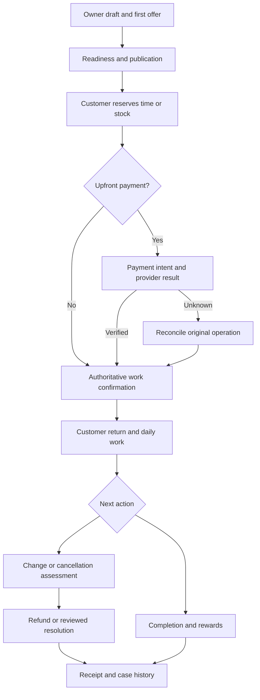

# Connected workflows

One canonical record/identity system across surfaces. Each packet below binds steps to contracts/commands.json and explicit failure/notification/terminal truth. Alternatives are not to be executed serially as if every branch occurs.

## Draft to first published offer

Commands: UpsertOnboardingDraft → BeginSignIn → ClaimOnboardingDraft → CreateOfferDraft → UpdateOfferDraft → UpdateOfferConfig → PreviewWorkingHoursImpact → ApplyWorkingHours → EvaluateReadiness → PreviewPublish → PublishPage.

**Recovery:** Account/provider return preserves draft; version conflict compares; readiness missing stays draft; publication requires exact reviewed revision; no auto-publish.

**Communication:** Only deliberate verified account/invite/security messages. No marketing from signup.

**Authoritative result:** Same Business/Offer IDs across onboarding/Studio/public page, public version distinct from draft.

## Service booking with optional deposit

Commands: CreateReservation → CommitBooking → StartPayment → GetOperation.

**Recovery:** No-upfront branches directly to confirmed only under configured instant/request rule; required payment remains pending; late success after hold expiry rechecks capacity then refund/recovery; retries same operation.

**Communication:** Confirmation once after authoritative state; pending says pending; necessary reminders recheck current date/status/version.

**Authoritative result:** Booking, Payment, DepositAllocation and AgreementSnapshot agree; redirect alone never confirmation.

## Native product order and fulfilment

Commands: CreateReservation → CreateOrder → StartPayment → GetOperation → UpdateFulfilment.

**Recovery:** Last unit transaction; invalid variant/shipping total re-review; partial fulfilment explicit line quantity; unknown capture reconciles; abandoned holds expire once.

**Communication:** Order/receipt/collection/dispatch separate template triggers; no campaign opt-in assumed.

**Authoritative result:** Money captured and line-level stock/fulfilment tracked independently.

## Class, participants and waitlist

Commands: CreateReservation → CommitBooking → JoinWaitlist → UpdateWorkOutcome.

**Recovery:** Seats count participants; if full, explicit uncharged waitlist, not simultaneous booking+waitlist; promotion FIFO whole party with timed offer, no auto-charge.

**Communication:** Attendee reminders use actual occurrence/timezone; waitlist notice is scoped operational contact.

**Authoritative result:** Capacity/host/room allocations and participant rights persist; package credit separate record/ledger requirement.

## Quote-led mobile/creative work

Commands: SendMessage → CreateQuoteDraft → AcceptQuote → CreateReservation → CommitBooking → StartPayment → UpdateWorkOutcome.

**Recovery:** Enquiry/quote acceptance not automatically schedule; material scope/price variation requires fresh acceptance; unsupported address blocks actual booking, not silent higher price.

**Communication:** Quote/deliberate variation/review notices protect private files/address.

**Authoritative result:** Accepted scope/version plus actual separate reserved date and payment authority.

## Reschedule, cancellation and refund

Commands: RescheduleBooking → AssessCancellation → ApplyCancellation → RequestRefund → GetOperation.

**Recovery:** Reschedule and cancellation are alternatives; stale assessment re-evaluates; statutory/disputed loss review; partial paid goods/services separate; unknown refund retrieves original operation.

**Communication:** Explain impact before action; cancellation recorded independent refund processing; durable receipt.

**Authoritative result:** No blanket keep-deposit; refund total bounded by captured minus prior active refunds.

## Completed work to Wallet return and redemption

Commands: UpdateWorkOutcome → EarnReward → IssueWalletPass → ResolveRewardCode → IssueHolderChallenge → RedeemReward → RefreshWalletPass.

**Recovery:** Static QR resolves only; holder challenge protected current relationship; staff current grant; concurrent redeem at most once; source refund appends reversal/recovery.

**Communication:** Wallet update queued is not immediate display; programme marketing permission separate.

**Authoritative result:** Append-only reward ledger authoritative; provider cache/offline screenshot never account authority.

## Draft to approved campaign and suppression

Commands: CreateCampaign → PreviewCampaign → ApproveCampaign → ScheduleCampaign → WithdrawMarketing → PauseCampaign.

**Recovery:** Unsubscribe is independent anytime, not mandatory step after scheduling; approval invalid after edit; dispatch rechecks consent; definite rejection releases quota once; unknown provider acceptance reconciles.

**Communication:** No optional promotion in operational templates; no provider failover bypassing suppression.

**Authoritative result:** Recipient-send accounting vs actual provider segments, one logical send per purpose/source/recipient.

## Staff invite, work and departure

Commands: InviteMember → UpdateOwnTeamProfile → PublishTeamProfile → RevokeMember → RevokeWalletPass.

**Recovery:** Removed membership/session/grants/cache access immediately; future accepted work reviewed/reassigned with customer rights; public link current fallback not unrelated employer.

**Communication:** Invitation deliberate; departure/assignment notices minimise private data.

**Authoritative result:** Historic attributed actions/agreements retained; login/resource/profile/seller remain distinct.

## Report, proportionate restriction and appeal

Commands: CreateTrustReport → RestrictSubject → AppealDecision → ResolveAppeal.

**Recovery:** Report count alone not guilt; reviewer conflict logged; preserve accepted work/refunds/private receipts; restrict minimum scope and issue appropriate notice.

**Communication:** Reporter privacy and target reasons/evidence projections separated; no retaliation.

**Authoritative result:** Decision versions/case/audit and appeal outcome with actual workforce authority.

## Subscription change, domain/record exit

Commands: ChangePlan → ExportBusiness → CloseBusiness.

**Recovery:** Downgrade next renewal; excess offer/location selection deliberate; obligations and required receipts/rewards retained; legal holds restrict deletion; domain ownership/renewal distinct SaaS cancel.

**Communication:** Notice actual effect/date/export choices; no deletion from marketing unsubscribe.

**Authoritative result:** Closure completion requires resolved accepted work/refunds/retention; not one global deleted boolean.

## Unknown provider state to Console recovery

Commands: OpenSupportCase → GetOperation → ReconcileProvider.

**Recovery:** Current authorised Console reconciles actual provider reference; no guessed payment/refund/manual data edit; restore pauses side-effect replay until provider truth matched.

**Communication:** Persistent case next owner/action; genuine status update not false success toast.

**Authoritative result:** Operation/audit/ledger/provider agreement with evidence trail.

## Reference event order

