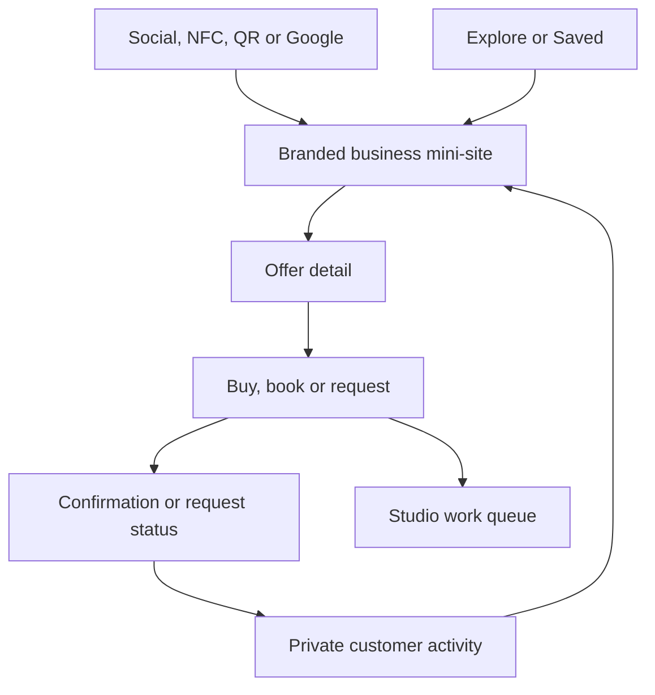
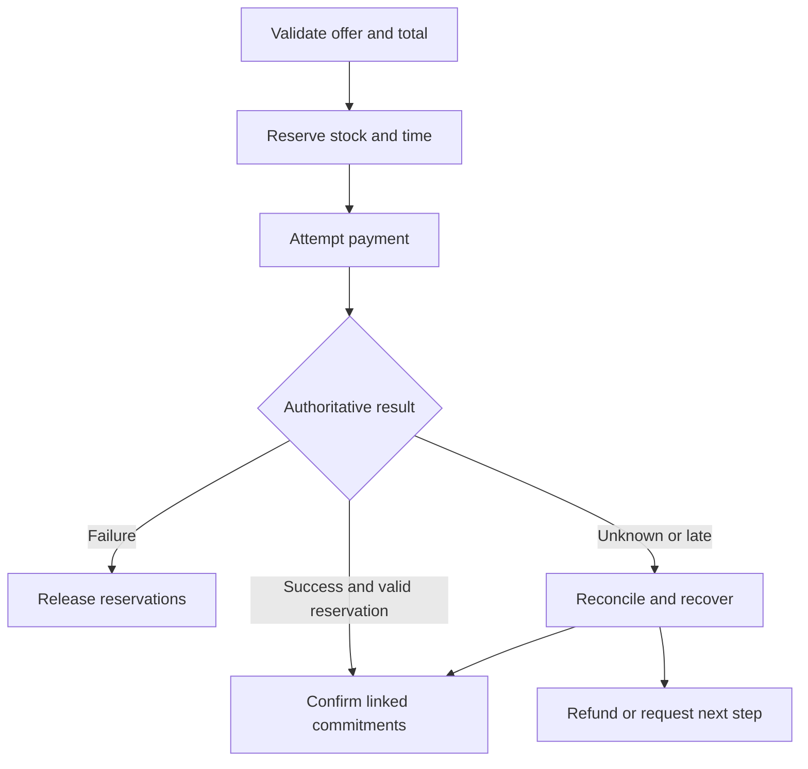
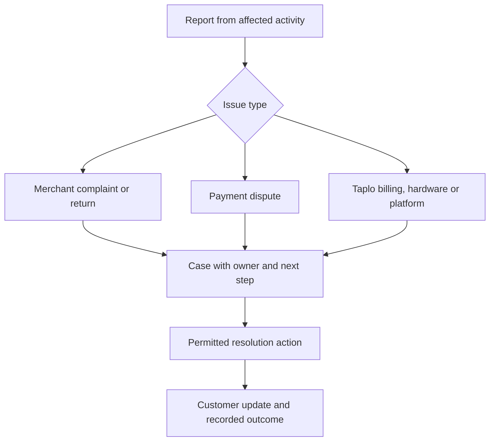

# Connected workflow maps

Status: recommended behaviour. These diagrams describe product responsibilities, not mandatory services.

## Entry and return

Explore/Saved entry retains its return context. Direct entry remains brand-first. A secure private record can require verification without forcing an app installation.

## Product and appointment coordination

The result must reflect actual reservation/payment state. Recovery can take time; the customer's UI explains pending status and prevents duplicate purchase attempts.

## Support escalation

A case can link several tracks. Its status does not replace order, payment, return or dispute status. See 23–24 for permission and deadline rules.
