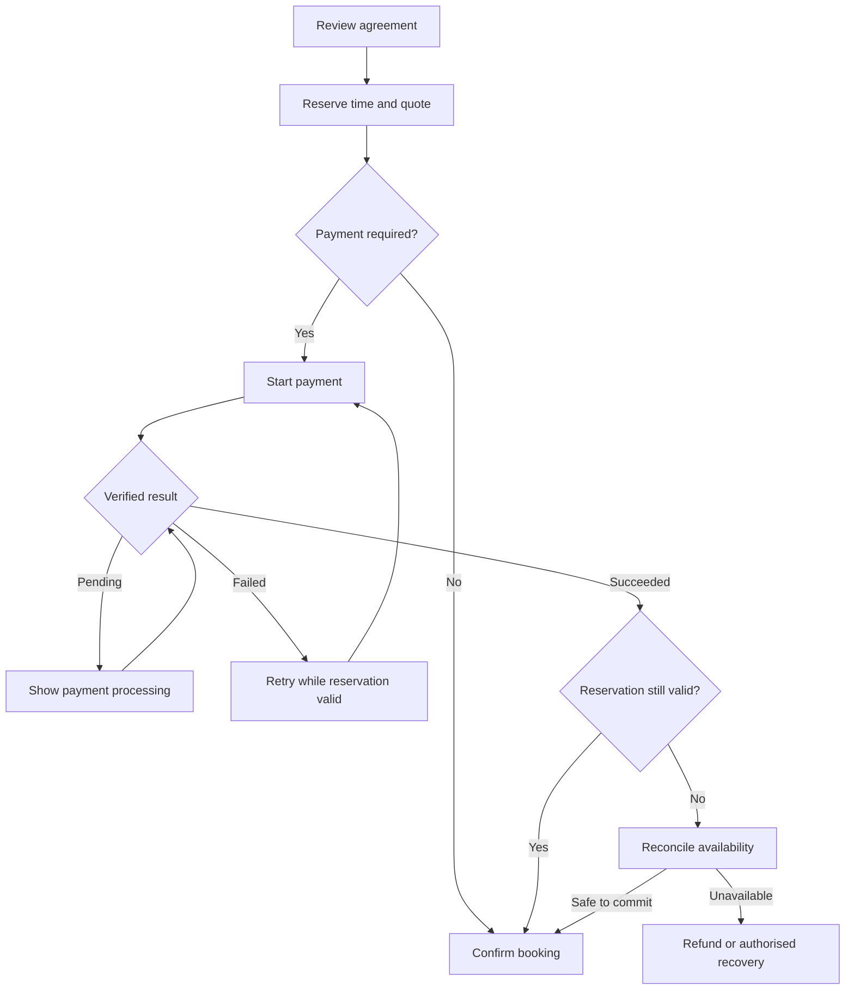

# 82 · Payments, deposits and cancellation design

Working edition 1.2 · 3 November 2026 · Recommended UK-first design for review. Extends 13–16, 24, 63–67 and 74–76. This is a funds-flow and product contract, not final legal terms or a Stripe agreement.

## Recommended responsibility model

The merchant contracts with the customer for its goods/services. Taplo supplies the software and is separately the seller of its own hardware/subscriptions. Evaluate Stripe Connect direct charges with merchant access to the full Stripe Dashboard and a configuration assigning connected-account payment losses to Stripe where eligible. This aligns with the founder's preference for less financial intervention; it remains subject to actual provider availability, underwriting, jurisdiction and contractual confirmation.

Direct charges are not enough by themselves: charge placement, fees, negative-balance responsibility and account/dashboard control are separate choices. Stripe's current risk documentation distinguishes those responsibilities; it also describes preview API configurations. Do not make a preview API a launch dependency or infer an approved risk allocation from a marketing label. Record the chosen supported API/account configuration before implementation. [R43–R44]

Do not pool merchant funds in Taplo's ordinary bank account, describe a deposit as escrow, or promise Taplo guarantees merchant performance. Separate merchant checkouts; do not launch a cross-merchant bag requiring split settlement. A saved payment method is scoped to the actual provider account and consent, not automatically reusable across Taplo businesses.

## Studio setup and readiness

Studio Settings → Payments shows Connect payments, verified seller identity, provider readiness, supported currency/methods, payout visibility and link to the provider dashboard. Use hosted/embedded provider onboarding for sensitive verification; Taplo should not duplicate bank identity collection unnecessarily. Returning from onboarding does not prove readiness: verify account requirements and relevant capabilities.

Readiness states: Not connected; Setup required; Under review; Ready for the selected payment method; Restricted; Disconnected. Explain the blocked action and next step. Do not infer payouts-ready from charges-ready. A merchant can draft offers before payment setup; online-paid offers cannot silently become publicly payable until all required states are ready.

Payment-method eligibility follows the workflow. Prefer methods with timely finality for scarce appointments; asynchronous methods need an explicit pending-capacity policy. Do not confirm a slot merely because an asynchronous payment was initiated.

## Offer-level controls

| Setting | Meaning | Guard |
| --- | --- | --- |
| No upfront payment | Booking commitment without an online advance | Clear balance/payment-at-visit wording; no secret card charge |
| Fixed deposit | A specified amount paid now toward the total | Positive amount not above fixed total; currency-safe minor units |
| Percentage deposit | A percentage of the eligible quoted total | Defined base, rounding and tax/discount treatment; never float arithmetic |
| Full upfront payment | Entire quoted amount paid now | Cancellation/refund rights still apply |
| Card guarantee | Authorised stored method for specified later charges | Separate explicit consent/mandate, permitted amount basis and provider support |
| Request approval | Customer requests time/scope before acceptance | Recommended first design: approve request, offer a time-limited payment step, confirm only after required payment succeeds |

No-upfront is the initial neutral state. Guided category recommendations explain protection and friction rather than switching charging on without merchant confirmation. Fixed-price appointments are a better first deposit workflow than unknown-price work. Quotes need an approved scope/amount before collecting a percentage; variable work can use a clearly priced assessment visit instead of an invented total.

Changing settings applies to future agreements. Existing bookings retain their price, deposit, balance, cancellation policy/version and mandate evidence. A bulk policy change previews affected future offers and does not retroactively rewrite customer agreements.

## Customer review

Show actual seller, service/person/location, date and timezone, total, amount due now, remaining amount and when/how it is due, cancellation summary and full policy access. Use Pay £20 deposit or Pay £80, not a vague Continue where a charge is about to occur. Record the accepted agreement snapshot and payment authority. Marketing choices remain separate and optional.

Booking, payment, refund and fulfilment are separate records. Payment confirmation requires authoritative verification. A redirect or email alone cannot establish financial success. Issue one durable booking summary and one defined payment receipt source; avoid duplicate contradictory receipts from Taplo and the provider.

## Deposit example and cancellation outcomes

For an illustrative £80 service with £20 paid now, the scheduled balance is £60. The deposit is part-payment, not an extra fee. A cancellation does not automatically mean the merchant keeps £20. UK CMA guidance requires fair terms and reasonable loss-based cancellation treatment; reasonable mitigation matters. Legal exceptions and cooling-off/early-performance rules require offer-specific review. [R48; specs 74–76]

| Event | Product response | Financial handling |
| --- | --- | --- |
| Customer cancels within a valid free-cancellation window | Show confirmed cancellation and refund progress | Refund eligible advance; do not call it complete until confirmed |
| Late cancellation/no-show | Calculate policy outcome; allow waiver/review and customer challenge | Never blanket automatic forfeiture irrespective of circumstances or rights; no duplicate recovery of the same loss |
| Merchant cancels/cannot provide service | Offer customer-controlled alternative or cancellation | Refund amounts owed; reschedule credit is a choice, not forced substitute |
| Customer reschedules | Recheck staff/resource/time and present policy/price impact | Transfer deposit allocation only with valid agreement; avoid charging the same deposit twice |
| Merchant changes scope or price | Issue variation for acceptance | Additional amount requires authority; no silent larger card charge |
| Slot later resold | Record mitigation relevant to cancellation assessment | Review retained fee against loss; support partial refund/waiver |
| Chargeback opened | Separate dispute case with provider deadline | Avoid an uncoordinated second refund; surface funding/evidence status |

A processor fee may remain a merchant cost after refund. Do not automatically deduct it from the customer's statutory refund. Currency, rounding, tax records and application-fee reversal must be specified for the selected arrangement. Taplo fees and card fees are distinct; pricing remains undecided.

## Card storage and remaining balance

Taking a deposit does not by itself grant permission to debit the balance or a cancellation charge later. Use a provider-supported setup/consent flow stating the intended future charge. An off-session payment may fail or require customer authentication; produce Payment action needed and a safe customer payment link, not repeated hidden retries. Do not retain raw card numbers or security codes. [R49]

First recommendation for balance collection: clear customer-initiated payment link or authorised in-person collection, recorded against the booking. A manually recorded cash/card payment includes actor, amount and method and is visibly distinct from provider-verified online payment. Reversals correct the ledger; editing an old paid amount does not.

## Commitment and recovery flow

No distributed-system guarantee is inferred from the diagram. A finite reservation, deduplicated provider event, atomic internal capacity check and compensating recovery are required. Repeated callbacks cannot create another booking/charge. Expiry and payment success racing each other must be resolved against the recorded reservation and provider state.

## Console and merchant actions

Merchant: inspect payments for own business, initiate authorised refund, waive eligible fee, supply dispute evidence and follow provider actions. Finance permissions differ from calendar access. Console: inspect a redacted transaction timeline and provider correlation IDs; diagnose mismatch; run an approved idempotent reconciliation; escalate. Refund/payout/bank-detail changes need specific role, reason, step-up where appropriate and audit. Never offer an unrestricted Fix payment button.

Case ownership: merchant owns supply-quality decisions; Taplo owns its software errors and support coordination; provider/card network governs its financial processes. Contracts must match actual capabilities. Disconnection/merchant closure cannot erase historic refund/dispute obligations; retain restricted access and escalation path under the retention/exit design.

## Required scenarios before release

Duplicate submit; provider timeout after successful charge; delayed success after reservation expiry; two customers competing for one slot; DST boundary cancellation cutoff; deposit larger than changed total; partial refund followed by dispute; staff cancellation; merchant account restricted mid-checkout; insufficient refund funding; consent missing for later charge; fee waiver; resold slot; merchant leaving with upcoming appointments. Record expected customer/merchant/Console state and financial reconciliation for each.
