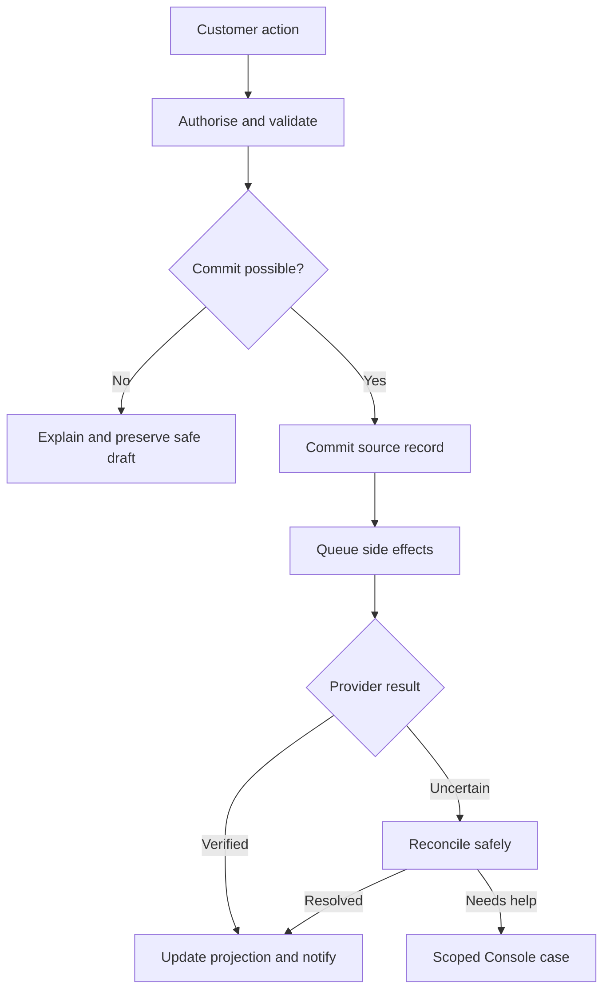

# 86 · Cross-surface feature and failure contract

Working edition 1.2 · 3 November 2026 · Proposed blueprint detail. This is how to deepen a feature beyond its name. New proposed records/fields below are not yet included in the existing typed JSON schemas; implementation must reconcile and validate them before treating them as an API contract.

## Shared engine responsibilities

Separate identity/assets and appearance tokens from offer rules, availability, financial agreements, communication delivery and search projections. A skin cannot change permission or payment logic. A calendar colour cannot establish availability. A success animation cannot create a booking. The same authorised command serves website action, merchant page and customer app rather than separate conflicting business logic.

Render a merchant logo from a validated asset with intrinsic dimensions, aspect-ratio handling, crop/contain intent and safe background treatment. Do not assume all logos are square, black or transparent. Sanitise/transform uploads safely, retain provenance and generate appropriate renditions; no uncontrolled remote SVG execution. A wordmark/name identity rule avoids accidental duplication; decorative absence collapses cleanly without invented initials. Long names, wide marks, dark marks, missing images and asset failures belong in visual review fixtures.

Theme switching changes tokens, not authored content or offer IDs. Preview and published revisions are distinct. Undo applies to editable local draft history, not completed refunds/charges. Publishing snapshots the intended page/configuration revision and validates readiness; it must not inadvertently publish a teammate's unreviewed changes. Concurrency/version conflict shows a useful recovery choice rather than last-write-wins data loss.

## Deposit feature across all surfaces

| Surface | Required elements/actions | States and authority |
| --- | --- | --- |
| Studio offer editor | Upfront choice, fixed/percentage amount, balance timing, policy summary, preview and Save | Draft/invalid/ready; owner/financial configuration permission; warn about future-only impact |
| Customer review popup | Seller, total/pay-now/balance, appointment, cancellation summary, payment CTA | Loading/quote changed/expired/processing/failure/confirmed; close/back retain safe draft |
| Activity detail | Amount paid, remaining, upcoming task, cancel/reschedule eligibility and support | Verified current record; private access; no stale auto-charge button |
| Staff calendar detail | Booking/payment status needed for work; permitted collection action | Calendar access alone does not expose payout/bank data or grant refund rights |
| Merchant payments | Transaction/refund timeline, permitted refund/waiver and provider access | Scope to merchant and financial role; partial/processing/failed outcomes explicit |
| Console case | Redacted facts, agreement version, operations/events and owner assignment | Read access separate from correction/refund actions; audit all sensitive access/actions |
| Communications | Correct confirmation/receipt/refund purpose and next action | Trigger only from committed state; queued stale reminders invalidated |

Popup appearance choices never hide mandatory financial facts or close/help affordances. A payment in progress may allow leaving with a status explanation; it must not imply leaving cancels a charge already submitted. Confirmation screen exposes Manage booking, not a forced app-install gate. App promotion can be a secondary benefit after the task.

## Additional data decisions required

PaymentPolicyVersion: merchant/offer scope, upfront mode, amount/basis, currency, rounding, effective version, cancellation rule reference and review scope. Accepted snapshot belongs to the booking, not a mutable theme record.

PaymentAuthority: provider account/method reference, authorised use/amount basis/timing, acceptance evidence, revocation and related agreement. Card token existence is not authority.

DepositAllocation: source payment, booking/agreement, amount, currency, outstanding/refunded/reallocated amount and adjustment origin. Preserve a ledger trail; avoid a mutable depositPaid boolean as financial truth.

NotificationIntent/DeliveryAttempt: event and template version, purpose, recipient role/channel, lawful authority reference where appropriate, dispatch deadline, suppression/deduplication key, provider correlation and status timestamps. Separate business event from channel attempts.

IntegrationHealth: provider/connection, selected capability, source window/cursor, last verified sync, freshness policy, required action and error classification. Store secrets outside broadly readable records.

These proposals need exact field types, nullability, server authority, invariants, permission scope and migration strategy added to 63–65 and machine schemas in a later contract revision. They are explicitly identified work, not hidden behind the existing schema count.

## Smart means deterministic before AI

Compute next-step recommendations from capability readiness and role. Explain why a setting is required; link directly to the smallest missing task. Use consistent dependencies so a business cannot enable instant booking without eligible time/resources, or online deposits without payment readiness. Mixed businesses adopt capabilities independently; a category label alone cannot activate a risky workflow.

Examples: solo barber sees service/time/deposit setup; mobile repair sees coverage/intake/assessment/quote choices; tutor sees guardian/payer/learner and session format; retail sees stock/variants/collection/delivery; workshop sees dated capacity/attendee/cancellation rules. These adapt guidance and controls while preserving one coherent underlying system. Detailed category validation remains required beyond these examples.

## Whole-system failure rehearsal

A provider-dependent financial action may require a reservation before source commitment; use the specific payment flow in 82. This general diagram must not override it. Search, email, Wallet and external calendar are projections/side effects with their own states; a failed projection must not silently rewrite the underlying transaction.

## Coverage rule

A feature is ready for construction only when actor/permission, exact record authority, setup, happy path, cancellation/change, failures, customer wording, mobile/desktop composition, light/dark, privacy/retention, Console recovery, economics and verification scenarios are specified to the required depth. Research can expose omissions and reduce avoidable rework; it cannot establish zero bugs or guarantee only minor changes after user observation.
